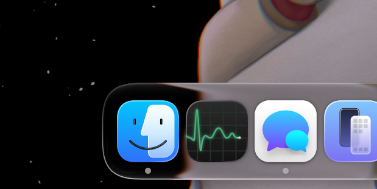
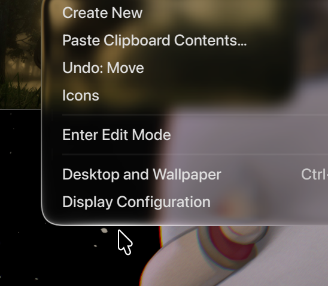
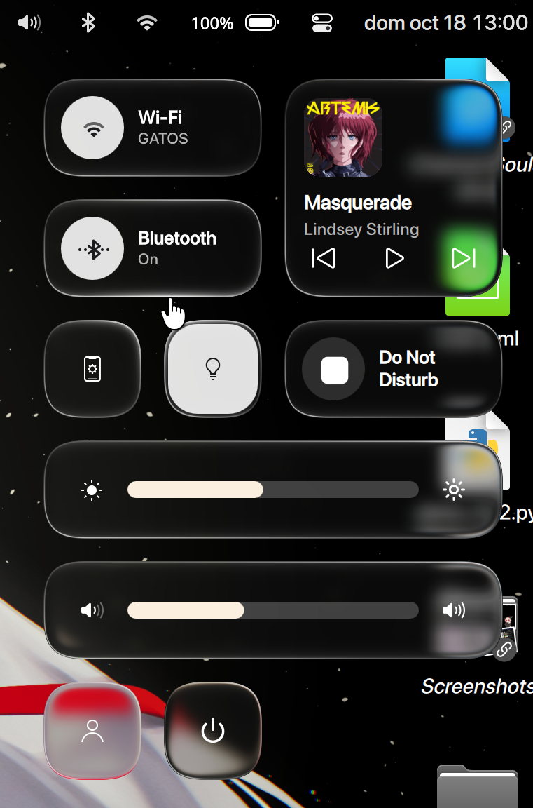
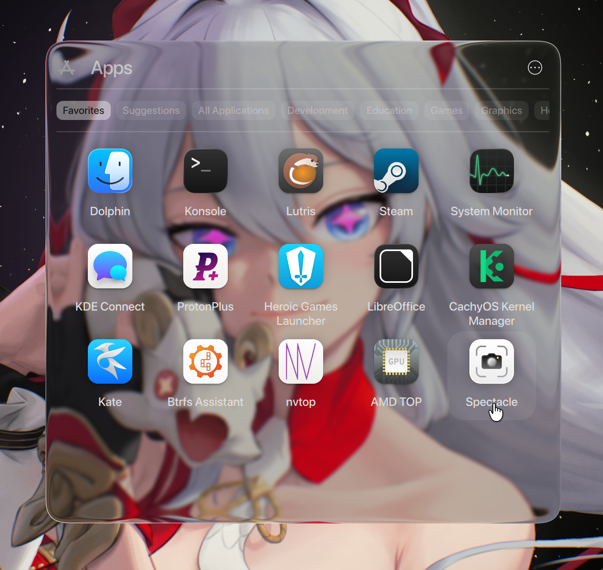

# Glass (fork)

A fork of [4v3ngR/kwin-effects-glass](https://github.com/4v3ngR/kwin-effects-glass), the liquid-glass
fork of the Plasma 6 blur effect, with a few extra rim and corner options and a fix for glass that
broke on windows animated by other KWin effects.

Tested on Plasma 6.8 (Wayland). See [CHANGELOG.md](CHANGELOG.md) for everything that differs from upstream.

---

## Perfect antialiased glass



Edges of glass surfaces stay smooth instead of showing stair-steps, even on small shapes like a dock.
Turn on **Smooth edge antialiasing (widget style)** in the *Refraction + Rim* tab.

## Border shine that follows the mouse cursor



The rim of a glass surface lights up near the pointer, like light catching the edge of real glass.
- **Cursor light** with a strength slider (*Subtle* to *Strong*)
- Adjustable brightness, thickness and radius of the light

## More squircled corners



Corners can use a squircle curve instead of a plain circular arc, which gives the softer, continuous look
of the macOS tiles.
- **Squircle corners** with a *Rounder* to *Squarer* slider
- Separate corner radius for notifications

## Better border specular control



More control over how the border of the glass catches light, so large panels do not end up with a harsh edge.
- **Glow** and **Specular** can be switched on separately, each with its own slider (glow *Left* to *Right* with *Color mix*, specular *Thin* to *Wide*)
- **Rim width**, **Thickness** and **Radius** sliders, plus a glow color
- **Widget border light** (*Subtle* to *Strong*) for widget-style borders

## Fixed issues with scale in effects


Glass used to break on windows that other KWin effects scale or move, for example the
Bouncing Popups effect. The top of menus was cut off while they animated and a bright
line was left behind on top of them afterwards.

- While a window is scaled or moved, the glass now requests a repaint of the animated area plus a margin, so nothing is cut off and old pixels get erased
- The glass shape and the rim corner radius follow the scaled window
- Controlled by **Improve glass on scaled/animated windows** in the *General* tab (on by default; turn it off to get the original behavior)

---

## Installation

Packages (AUR, Fedora, openSUSE, NixOS) install the **upstream** version. To use this fork, build it from source.

Dependencies on Arch Linux:
```sh
sudo pacman -S base-devel git extra-cmake-modules qt6-tools kwin
```
Other distributions: CMake, Extra CMake Modules, Plasma 6, Qt 6, KF6 and the KWin development packages.
The [upstream README](https://github.com/4v3ngR/kwin-effects-glass#readme) lists the packages for each distribution.

Build and install:
```sh
git clone https://github.com//kwin-effects-glass
cd kwin-effects-glass
cmake -B build -DCMAKE_INSTALL_PREFIX=/usr -DCMAKE_BUILD_TYPE=Release
cmake --build build -j$(nproc)
sudo cmake --install build
```
Log out and back in, then enable **Glass** in *System Settings > Window Management > Desktop Effects*
(and turn off the default Blur effect).

> [!IMPORTANT]
> If the effect stops working after a system upgrade, rebuild and reinstall it.

## Credits

- [4v3ngR](https://github.com/4v3ngR/kwin-effects-glass) for the original Glass effect
- [@PKMNPlatin](https://github.com/PKMNPlatin/kwin-effects-snell-glass) for the Snell's law refraction shader
- Everyone credited in the upstream README for Plasma version patches and packaging

## License

GPL-3.0, the same as upstream. See [LICENSE](LICENSE).
